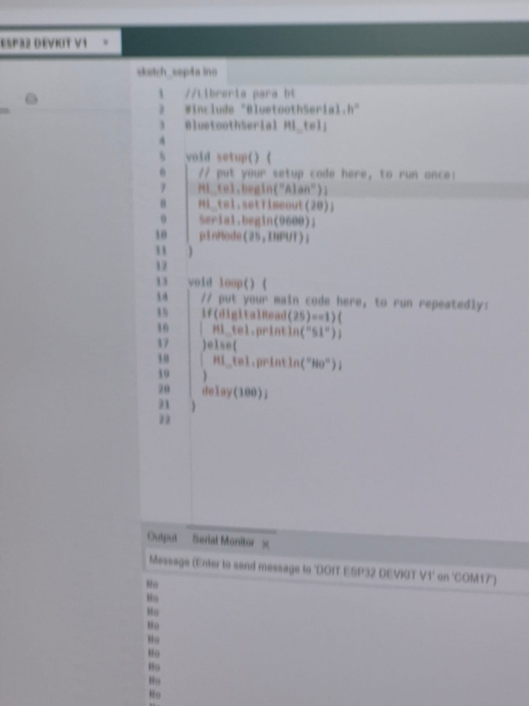

## Introducción

En la segunda práctica comenzamos a aprender las **bases de programación para microcontroladores**.

## Procedimiento

Utilizamos Arduino IDE para conocer la estructura básica de un programa. Aprendimos que `setup()` se utiliza para realizar las configuraciones iniciales y que `loop()` contiene las instrucciones que se ejecutan continuamente.

También aprendimos para qué sirven algunas instrucciones básicas, como `pinMode()`, `digitalWrite()`, `digitalRead()`, `delay()` y `Serial.println()`.

Uno de los primeros ejercicios consistió en utilizar el **monitor serial** para enviar mensajes desde el microcontrolador hacia la computadora.

Después comenzamos a trabajar con las **salidas digitales**. Aprendimos que los pines pueden cambiar entre los estados `HIGH` y `LOW`, lo que permite controlar componentes electrónicos.

## Evidencias

/// caption
Evidencia del primer programa
///

/// caption
Evidencia de programación de salidas
///

## Conclusión

Con estos ejercicios comprendimos mejor la estructura de un programa y la forma en que las instrucciones escritas pueden controlar los pines de un microcontrolador.
