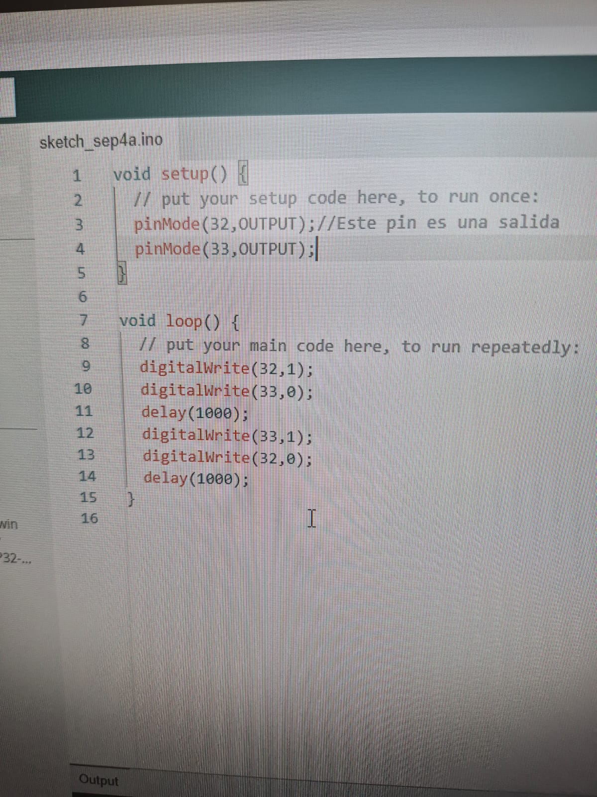
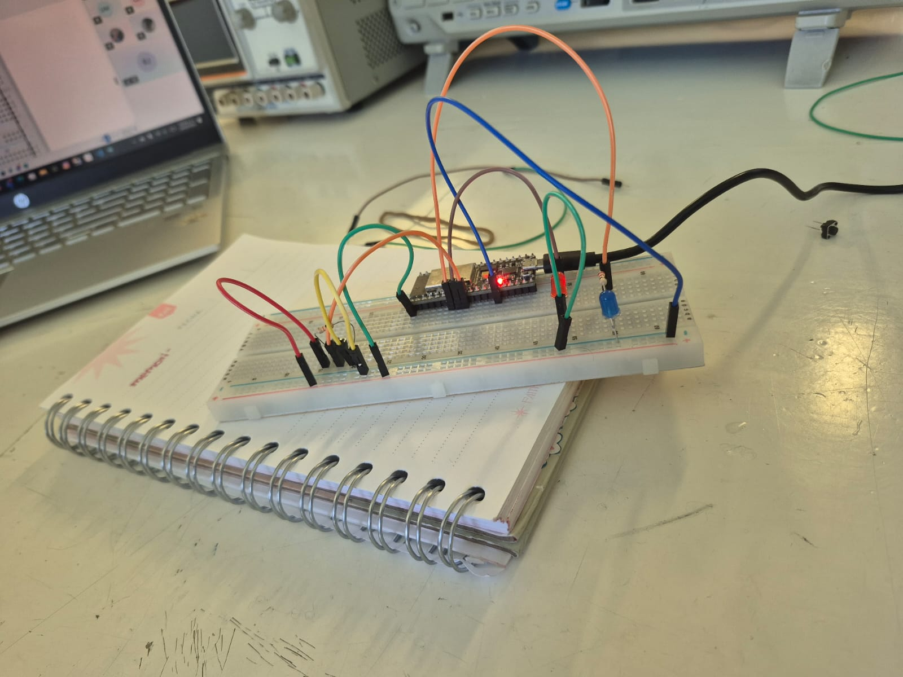

## Introducción

Después de trabajar con las salidas, comenzamos a utilizar las **entradas digitales**.

## Objetivo

El objetivo fue aprender a detectar mediante programación si un botón estaba siendo presionado.

## Materiales y herramientas

Para esta práctica utilizamos una **ESP32**, una protoboard, cables jumper, un botón y otros componentes electrónicos.

## Procedimiento

Para esto utilizamos una entrada digital y observamos el resultado mediante el monitor serial. Cuando el botón cambiaba de estado, el microcontrolador podía detectar este cambio y mostrar la información en la computadora.

## Evidencias

/// caption
Evidencia del código
///

/// caption
Evidencia del circuito
///

## Conclusión

Esta práctica nos permitió comprender mejor la diferencia entre una **entrada** y una **salida**.

Una entrada permite que el microcontrolador reciba información de un elemento externo, como un botón o un sensor. Una salida permite controlar otros componentes, como un LED o un motor.
