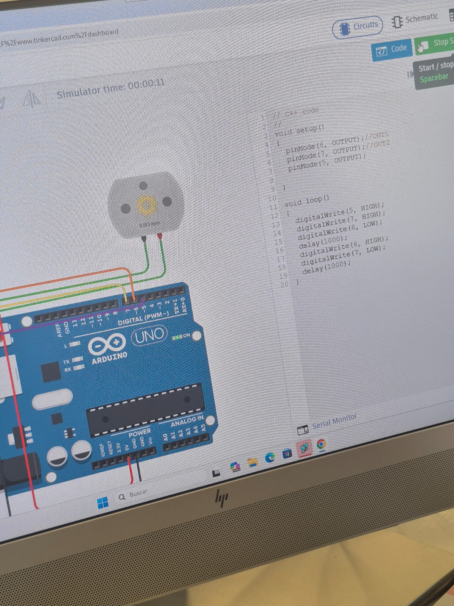
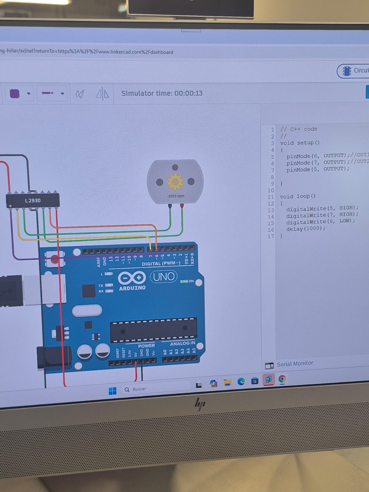
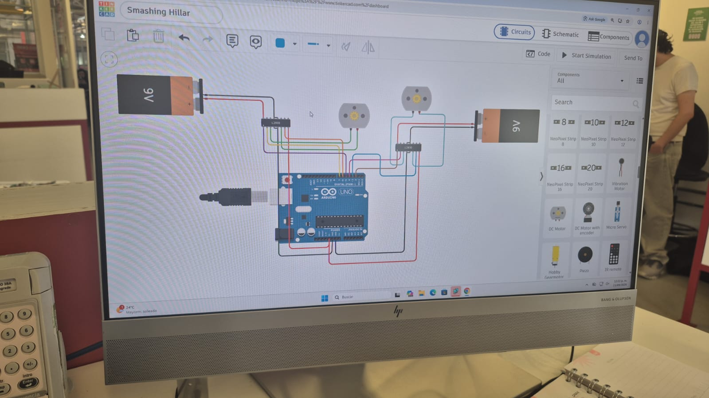

## Introducción

En otra de las prácticas utilizamos **Tinkercad Circuits** para simular un circuito antes de realizarlo físicamente.

## Objetivo

El objetivo principal fue aprender a conectar y controlar un **motor de corriente directa (DC)** utilizando un Arduino UNO.

## Materiales y herramientas

Para realizar el circuito utilizamos principalmente:

- Arduino UNO
- Motor DC
- Puente H L293D
- Batería de 9 V
- Cables de conexión
- Tinkercad Circuits

El **L293D** es un circuito integrado que funciona como controlador de motores. Permite que el Arduino controle el motor utilizando señales digitales.

## Procedimiento

Durante la práctica realizamos las conexiones entre el Arduino, el L293D y el motor. Después programamos los pines necesarios y ejecutamos la simulación para comprobar el funcionamiento.

Posteriormente realizamos un circuito más completo en Tinkercad, utilizando motores, controladores L293D y fuentes de alimentación.

## Evidencias

/// caption
Evidencia del circuito
///

/// caption
Evidencia del código utilizado
///

/// caption
Circuito completo en Tinkercad
///

## Conclusión

Esta simulación nos permitió entender mejor cómo se puede utilizar un microcontrolador para controlar el movimiento de un motor.

También aprendimos que Tinkercad es útil para probar un circuito de manera virtual antes de realizar las conexiones físicamente.
