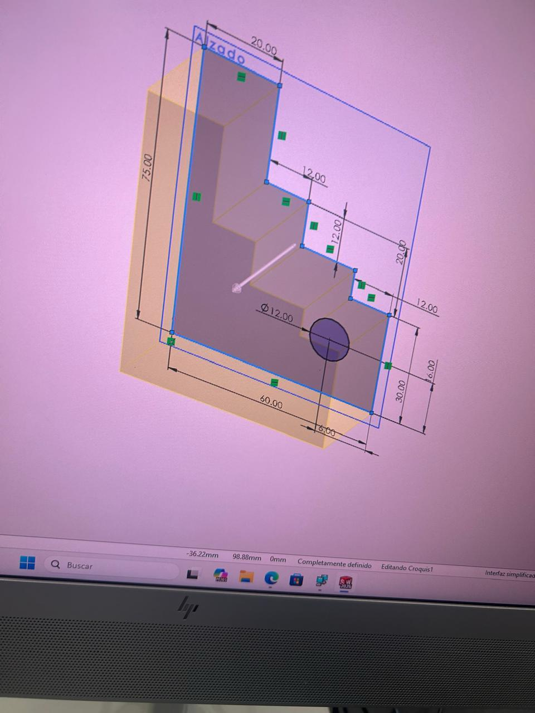

## Introducción

En la primera clase comenzamos a trabajar con **SOLIDWORKS**.

## Objetivo

El objetivo principal fue aprender a utilizar las herramientas básicas del programa y entender cómo se puede pasar de un croquis en dos dimensiones a una pieza tridimensional.

## Procedimiento

Durante esta práctica realizamos diferentes figuras. Una de ellas tenía una forma escalonada y contaba con distintas medidas y un orificio circular.

Para realizarla primero se creó el croquis, se colocaron las medidas correspondientes y posteriormente se utilizó la herramienta de **extrusión** para darle volumen.

También modelamos otra pieza con una forma diferente, en la cual utilizamos círculos, extrusiones y cortes.

## Evidencias

/// caption
**Pieza escalonada.** Croquis de la pieza escalonada realizado en SOLIDWORKS.
///

/// caption
**Pieza terminada.** Modelo tridimensional de una de las piezas realizadas.
///

## Resultados

Con estos ejercicios aprendimos a:

- Crear croquis.
- Colocar cotas y medidas.
- Utilizar la herramienta de extrusión.
- Realizar cortes.
- Crear orificios.
- Modificar un croquis.
- Convertir un diseño 2D en una pieza 3D.
