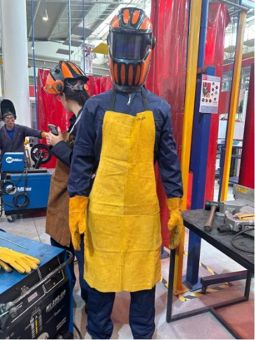
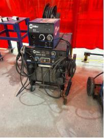

## Introducción

En otra de las clases trabajamos en el **taller de soldadura**.

Antes de comenzar fue importante conocer el equipo de protección personal que se utiliza para reducir los riesgos durante el trabajo.

## Materiales y herramientas

Entre el equipo utilizado se encontraba:

- Careta de soldar.
- Guantes de carnaza.
- Mandil de protección.
- Ropa adecuada para trabajar en el taller.

La **careta de soldar** protege principalmente los ojos y el rostro de la intensa luz producida durante la soldadura y de las chispas.

Los **guantes y el mandil** ayudan a proteger las manos y el cuerpo contra partículas calientes y pequeñas proyecciones de metal.

### Equipo de protección

/// caption
**Equipo de protección personal.** Uso del equipo de protección personal para realizar trabajos de soldadura.
///

/// caption
**Careta, guantes y mandil.** Equipo utilizado durante la práctica.
///

## Procedimiento

### Máquina de soldar

Durante la práctica también conocimos y utilizamos una **máquina de soldar**.

Este equipo permite generar el calor necesario para unir materiales metálicos. Durante el proceso se produce un arco eléctrico capaz de alcanzar una temperatura suficientemente alta para trabajar y unir el metal.

El uso de esta máquina requiere utilizar correctamente el equipo de protección debido a las chispas, el calor y la intensa luz generada durante el proceso.

/// caption
Máquina de soldar utilizada durante la práctica.
///

### Sierra sensitiva o tronzadora para metal

Otra de las máquinas utilizadas fue una **sierra sensitiva**, también conocida como **tronzadora para metal**.

Esta máquina utiliza un disco que gira a gran velocidad y permite realizar cortes en perfiles, barras y otras piezas metálicas.

Antes de realizar un corte, el material debe quedar correctamente sujetado en la prensa de la máquina para evitar que se mueva.

También es necesario utilizar el equipo de protección adecuado, ya que durante el corte pueden producirse chispas y pequeñas partículas de material.

!!! info "Evidencia pendiente"
    Fotografía de la sierra sensitiva o tronzadora utilizada para cortar metal (aún no agregada al repositorio).
