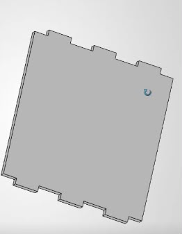
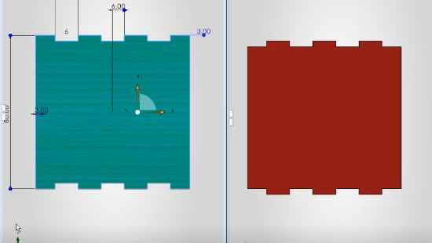
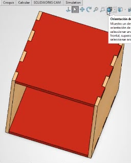

## Introducción

En la última práctica regresamos a **SOLIDWORKS** para realizar las piezas necesarias para formar un cubo.

Para conseguirlo diseñamos caras cuadradas con diferentes **pestañas y cortes en sus bordes**.

Estas pestañas están colocadas de manera que las diferentes caras puedan coincidir entre sí al momento de realizar el ensamble.

## Procedimiento

El procedimiento que seguimos fue:

1. Crear el croquis de la cara del cubo.
2. Colocar las medidas correspondientes.
3. Diseñar las pestañas y cortes.
4. Terminar cada una de las caras.
5. Crear las demás piezas necesarias.
6. Utilizar las herramientas de ensamblaje de SOLIDWORKS.
7. Comprobar que las piezas coincidieran correctamente.

### Diseño de las caras

/// caption
**Diseño inicial.** Diseño de diferentes caras para formar el cubo.
///

/// caption
**Cara del cubo**
///

### Ensamblaje

Después de terminar las piezas se utilizaron las herramientas de ensamblaje de SOLIDWORKS para colocarlas en la posición correcta.

Las pestañas y los cortes permiten que las caras coincidan entre sí para formar finalmente el cubo.

/// caption
Proceso de ensamblaje de las caras del cubo en SOLIDWORKS.
///

## Consideraciones

Durante esta actividad fue importante respetar las medidas y la posición de cada corte, ya que un pequeño cambio podía provocar que las piezas no coincidieran correctamente.
