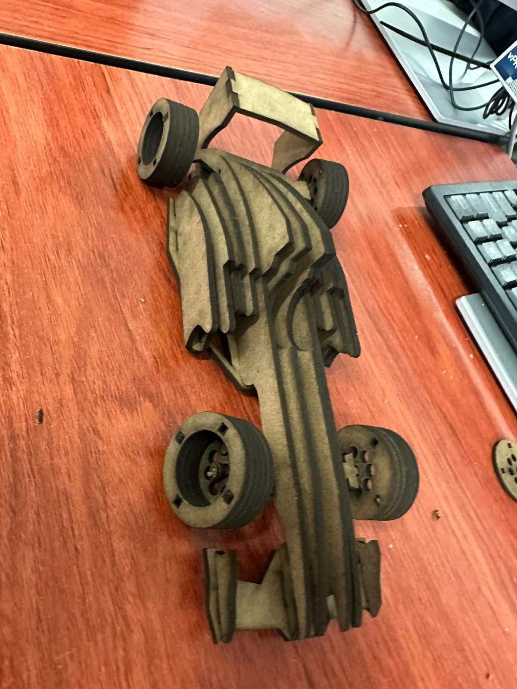
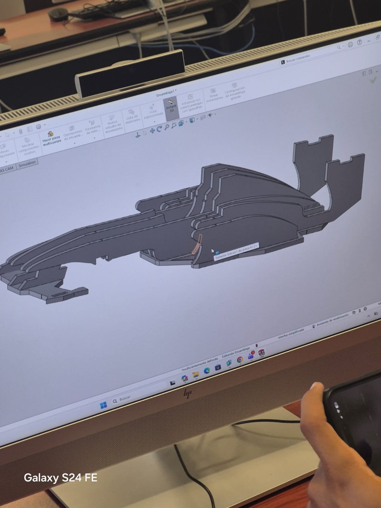
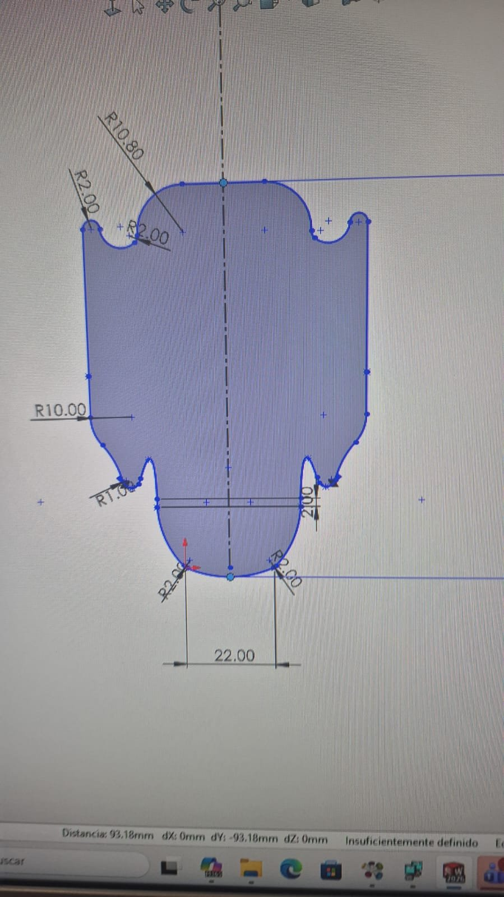
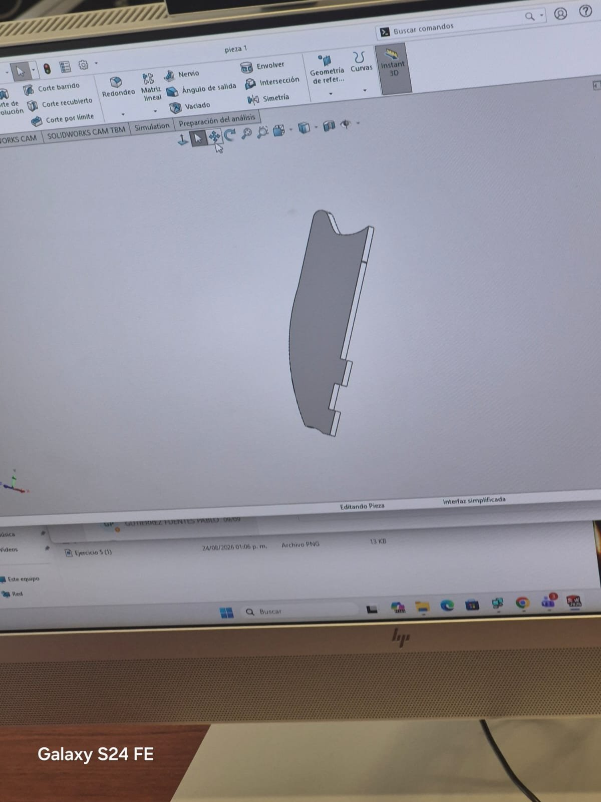
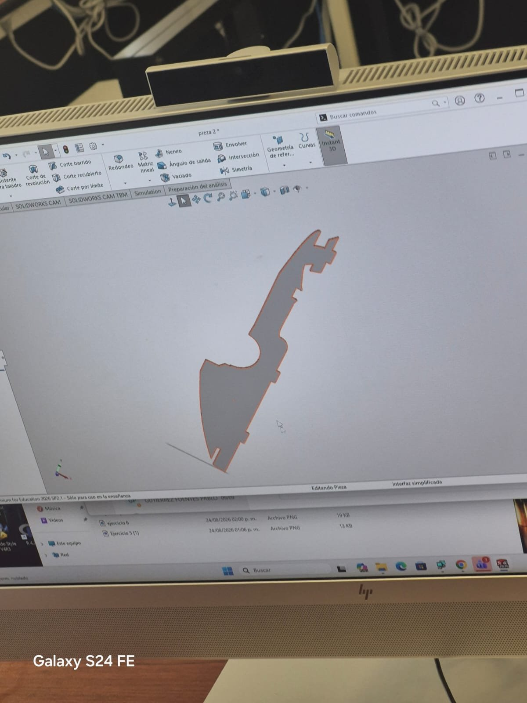
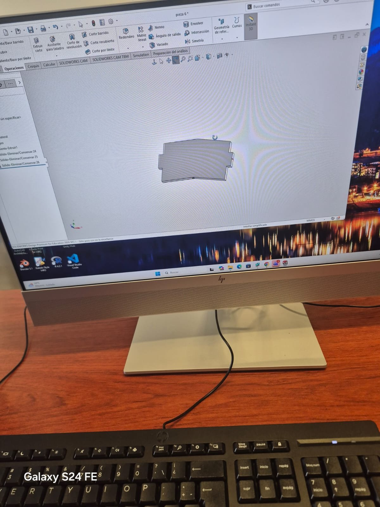
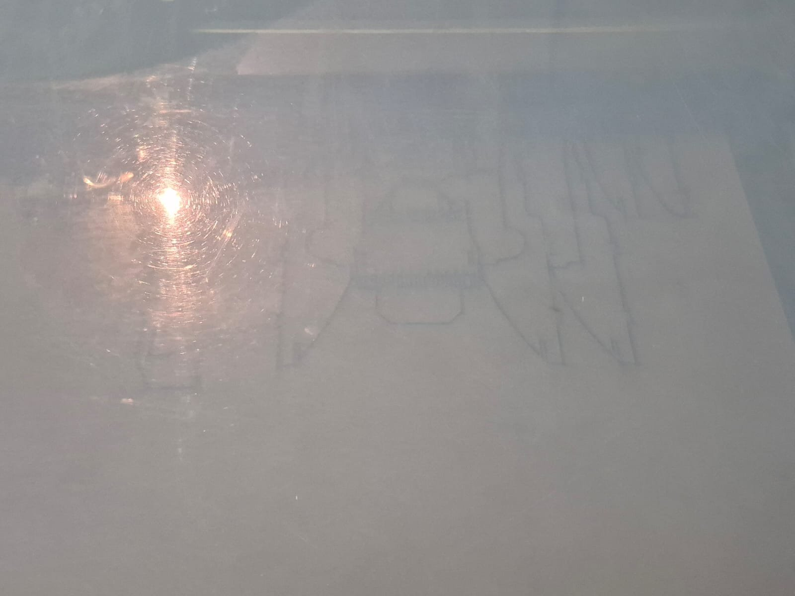
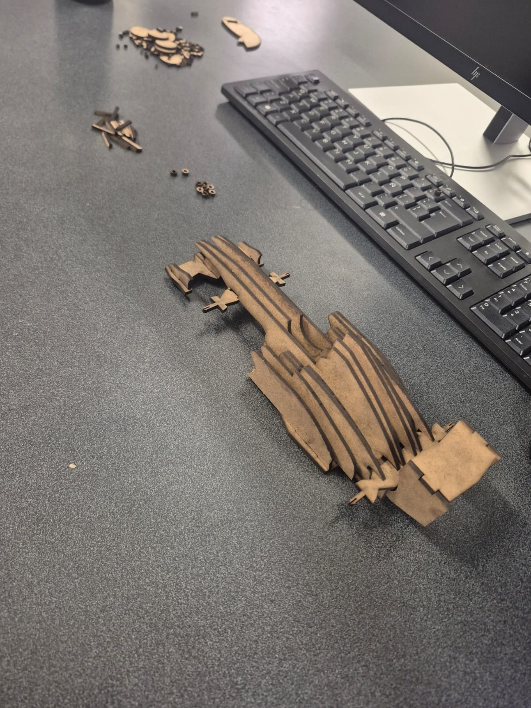
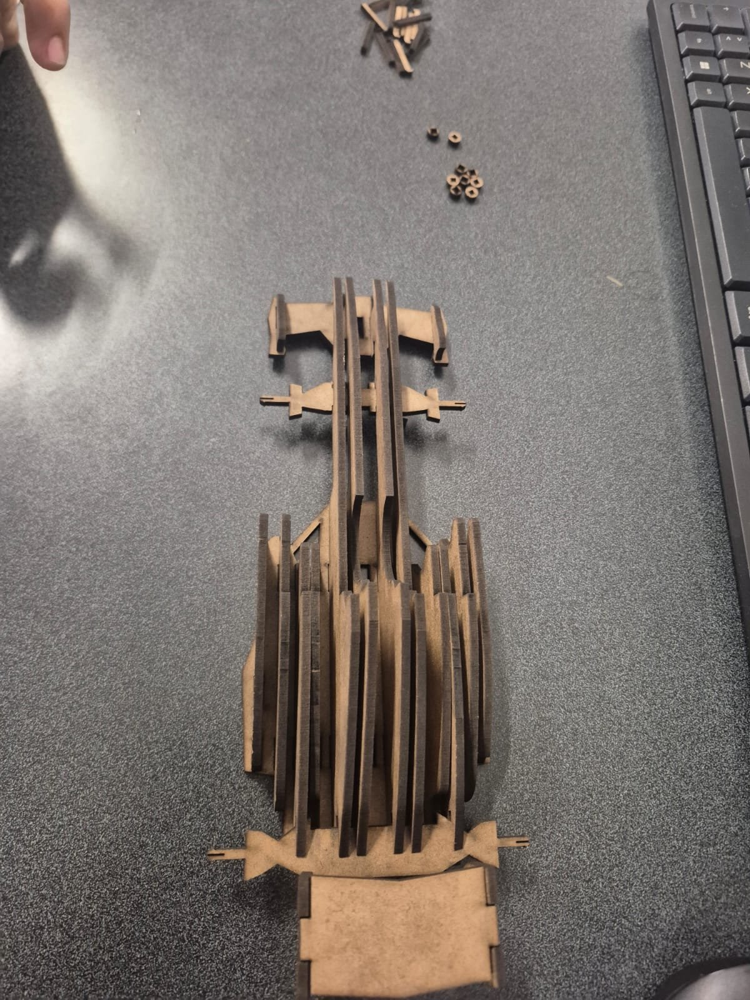

## Descripción

En esta práctica se desarrolló un carrito inspirado en los vehículos de Fórmula 1, con herramientas de diseño tridimensional y fabricación digital. Se creó un modelo propio en **SOLIDWORKS**, se prepararon sus componentes para el corte y después se unieron las piezas para obtener una estructura física.

La actividad permitió relacionar el diseño asistido por computadora con un proceso de fabricación real, considerando la forma de las piezas, su distribución y la manera en que debían conectarse para formar el vehículo.

/// caption
**Carrito terminado.** Vista del carrito de Fórmula 1 ya ensamblado.
///

## Parte 1: ensamblado digital

### Diseño en SOLIDWORKS

El primer paso fue construir digitalmente la forma del vehículo mediante piezas individuales. Se trabajó con las herramientas de modelado de SOLIDWORKS, dando forma a los elementos que conforman la carrocería y definiendo los cortes, relieves y espacios necesarios para unirlos.

El diseño se planteó para que las distintas partes pudieran acomodarse entre sí al momento del armado. También se preparó una base que después se descartó, así que fue necesario continuar con la propuesta que se adaptaba mejor al resultado buscado.

/// caption
**Modelo 3D.** Estructura del carrito en SOLIDWORKS.
///

/// caption
**Perfil acotado.** Contorno de una pieza con sus medidas.
///

/// caption
**Pieza de la carrocería.** Componente lateral diseñado en el modelo.
///

/// caption
**Otra pieza.** Elemento que se acomoda con el resto del conjunto.
///

/// caption
**Primera propuesta de la base.** Versión que se descartó durante el diseño.
///

## Parte 2: piezas del carrito

### Preparación para la fabricación

Después de desarrollar las piezas digitales, se prepararon sus contornos para el corte láser. Esta etapa fue importante porque el diseño debía conservar las formas y dimensiones necesarias para que los componentes pudieran fabricarse y ensamblarse después.

La distribución de las piezas se organizó según el espacio disponible en el material. Así, el trabajo pasó de una representación digital a componentes físicos que podían separarse y acomodarse de acuerdo con el diseño.

/// caption
**Corte láser.** Grabado y corte del contorno de las piezas.
///

/// caption
**Piezas cortadas.** Componentes separados antes del armado.
///

### Ensamblaje

Una vez obtenidas las piezas, comenzó el armado del carrito. Se identificó cada componente y se fue colocando según la forma en que debía relacionarse dentro de la estructura.

El ensamble requirió cuidado con la posición de cada elemento, sobre todo en las zonas donde varias piezas debían coincidir. El objetivo era que la carrocería mantuviera su forma y que los componentes principales quedaran bien integrados.

Durante esta fase, el modelo de SOLIDWORKS sirvió como referencia para entender la disposición de las partes y compararla con el armado físico.

/// caption
**Armado en proceso.** Carrito con varios componentes ya colocados.
///

## Resultado

Como resultado se obtuvo un carrito de Fórmula 1 fabricado con piezas cortadas con láser y diseñadas previamente en SOLIDWORKS. El proyecto mostró cómo un modelo digital puede convertirse en un objeto físico mediante la preparación de sus componentes y su posterior unión.

La comparación entre el diseño tridimensional y el resultado final también permitió apreciar la importancia de planear la posición y la forma de las piezas antes de fabricarlas.

## Conclusión

Elaborar el carrito fue una oportunidad para aplicar lo aprendido sobre diseño tridimensional y fabricación digital. En SOLIDWORKS se desarrollaron los componentes y se revisó cómo debían acomodarse, mientras que el corte láser permitió obtener las piezas necesarias para construir el modelo físico.

Una parte importante del trabajo fue entender que no basta con diseñar una figura que se vea bien en la computadora: también hay que considerar cómo se fabricará y cómo se unirán sus partes. Además, el cambio de la base inicial mostró la importancia de revisar las propuestas y hacer ajustes durante el desarrollo de un proyecto.

En general, la práctica reforzó el manejo de herramientas de diseño y ayudó a comprender mejor la relación entre el modelado CAD y la construcción de un prototipo físico.
