## Introducción

En esta práctica se conocieron los instrumentos que se usan para medir piezas y las herramientas que se emplean en los procesos de fabricación. La actividad incluyó el uso del calibrador Vernier y del micrómetro para obtener las dimensiones de bloques de madera, además de una explicación sobre el funcionamiento de distintas máquinas del taller.

El objetivo fue entender la importancia de medir bien los materiales antes de trabajarlos y reconocer las funciones principales de los equipos para cortar, mecanizar, doblar y unir piezas.

## 1. Medición de bloques de madera

Una de las actividades principales consistió en medir diferentes bloques de madera para conocer sus dimensiones. Para ello se usaron dos instrumentos de precisión: el calibrador Vernier y el micrómetro.

### Calibrador Vernier

Este instrumento permite medir exteriores, interiores y profundidades. Su funcionamiento se basa en una escala principal y otra deslizante, cuya lectura da la dimensión del objeto.

Sirve para medir el largo, el ancho y el grosor de una pieza, y también para revisar diámetros y profundidades cuando la geometría lo permite.

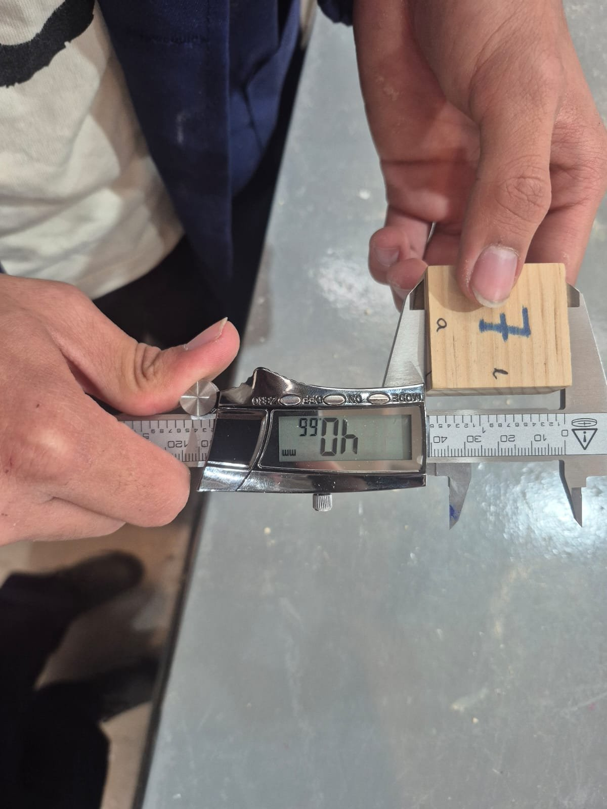
/// caption
**Calibrador Vernier.** Medición de un bloque de madera con la escala digital.
///

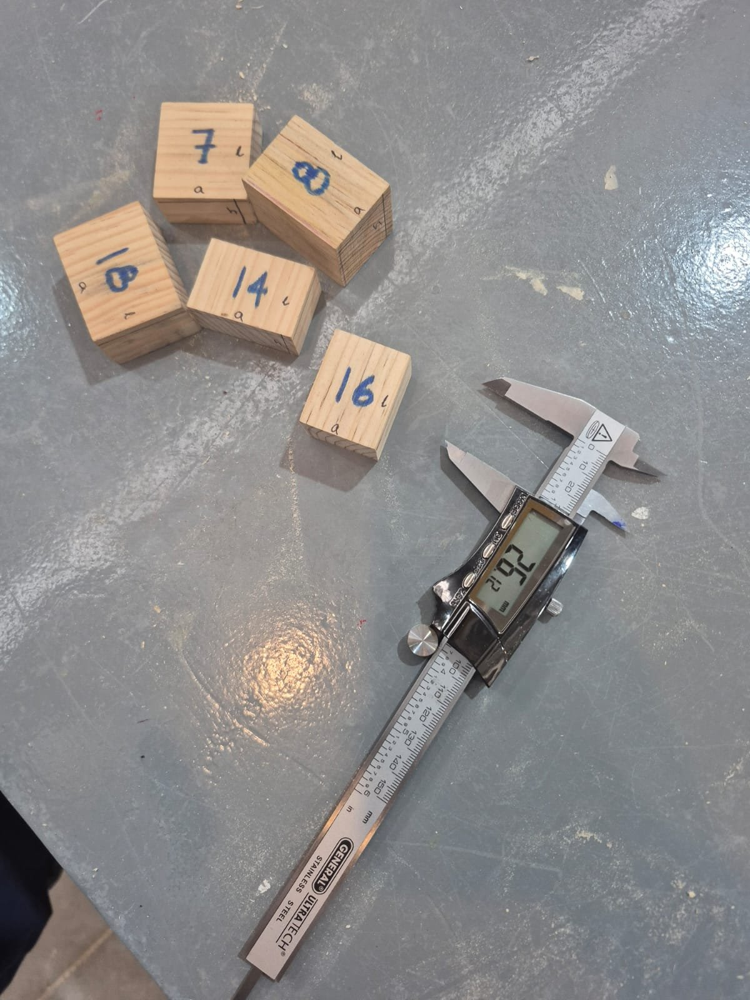
/// caption
**Medición con Vernier.** Lectura de las dimensiones de los bloques numerados.
///

### Micrómetro

El micrómetro hace mediciones precisas con un mecanismo de tornillo. La lectura se obtiene combinando la escala del cuerpo y la del tambor giratorio. El mecanismo de ajuste permite aplicar una presión controlada sobre la pieza mientras se mide.

Se usó como parte de la comparación dimensional de los bloques de madera.

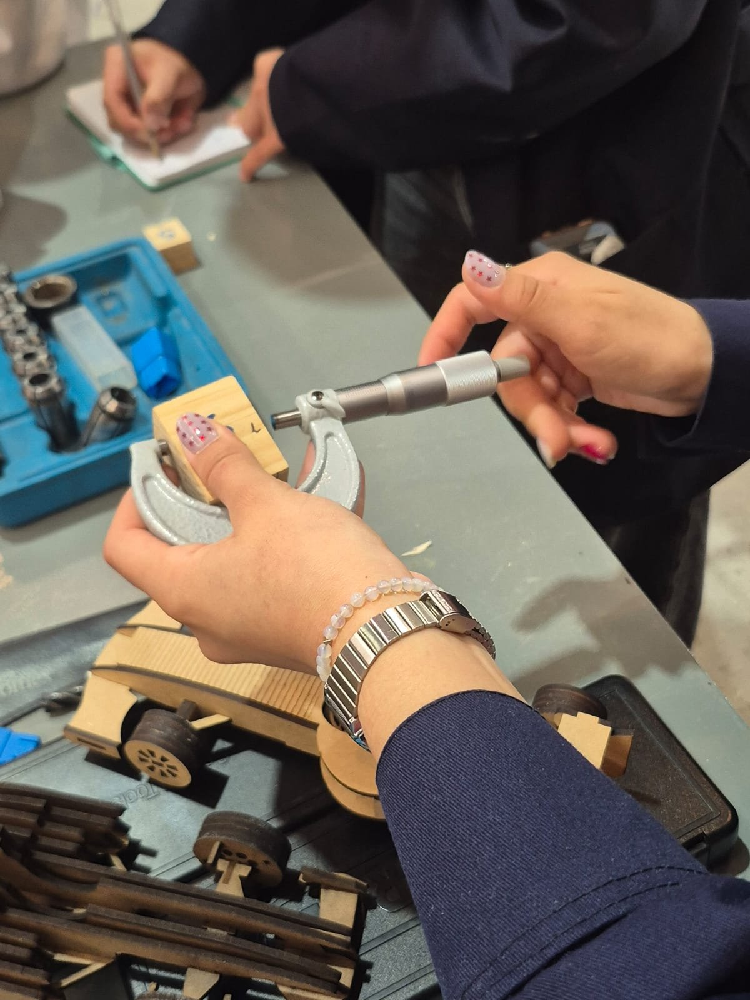
/// caption
**Micrómetro de exteriores.** Instrumento sujetando un bloque de madera.
///

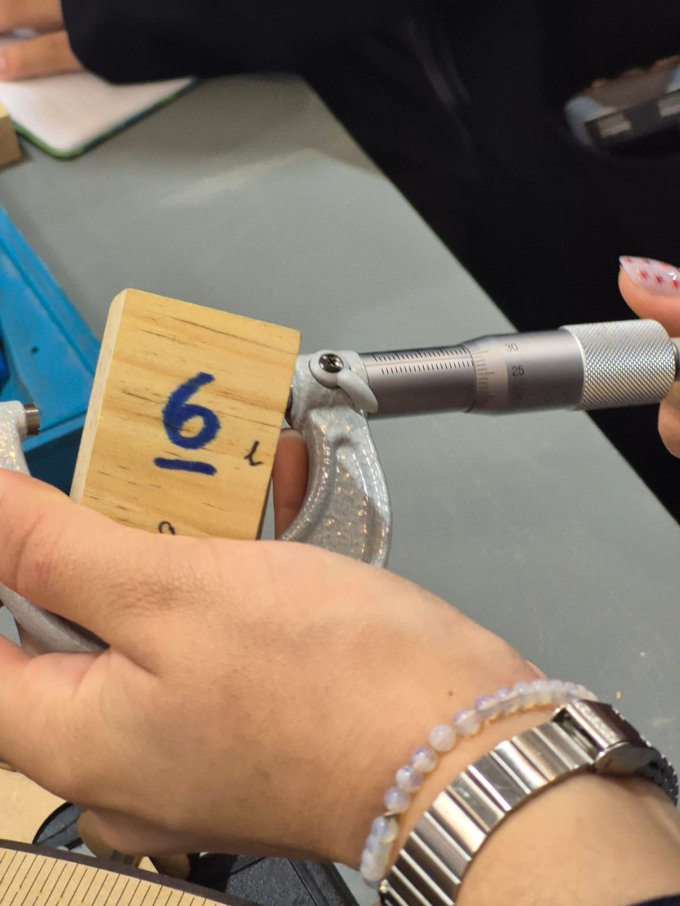
/// caption
**Lectura con micrómetro.** Medida tomada sobre uno de los bloques.
///

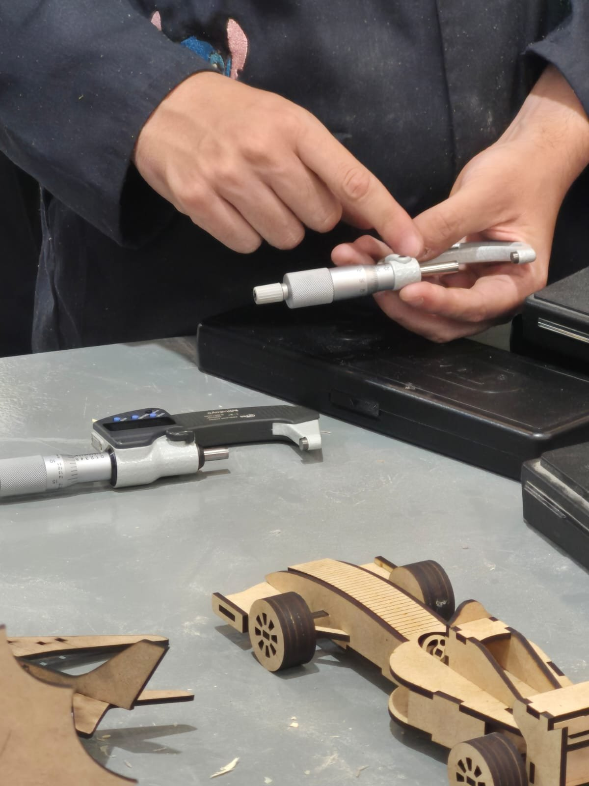
/// caption
**Micrómetro sobre la mesa.** Instrumento junto a las piezas de la práctica.
///

## 2. Registro de las dimensiones

Durante el ejercicio se registraron las medidas de los bloques identificados con números. Se tomaron tres dimensiones por pieza: largo, ancho y grosor. Los resultados se organizaron en tablas para consultarlos y compararlos con facilidad.

### Resultados con calibrador Vernier

| Bloque | Largo (mm) | Ancho (mm) | Grosor (mm) |
|---:|---:|---:|---:|
| 8 | 45.62 | 31.65 | 32.33 |
| 7 | 40.57 | 36.66 | 18.65 |
| 14 | 28.72 | 41.69 | 20.25 |
| 16 | 37.05 | 29.86 | 25.49 |
| 18 | 35.89 | 46.92 | 21.80 |

### Resultados con micrómetro

| Bloque | Largo (mm) | Ancho (mm) | Grosor (mm) |
|---:|---:|---:|---:|
| 5 | 27.45 | 24.11 | 23.17 |
| 6 | 43.25 | 32.27 | 28.43 |
| 14 | 29.27 | 42.16 | 20.25 |
| 15 | 50.48 | 47.37 | 21.69 |
| 17 | 41.14 | 32.21 | 25.00 |

Estos registros sirvieron para practicar la lectura de instrumentos y para ordenar las dimensiones con una unidad común. Como los bloques medidos con cada herramienta no fueron exactamente los mismos, no es posible comparar todos los resultados directamente; solo el bloque 14 aparece en las dos tablas.

## 3. Brocas y fresas

También se revisaron las diferencias entre dos herramientas de mecanizado.

La **broca** se usa principalmente para hacer agujeros con un movimiento de giro y avance en la dirección de la perforación. La **fresa** retira material para formar superficies, ranuras, rebajes y perfiles, según su geometría y el movimiento de la máquina.

La elección depende de la operación, del material y del acabado que se busque. Además, la cantidad y la disposición de los filos de una fresa influyen en su funcionamiento, así que no conviene elegirla solo por el número de filos.

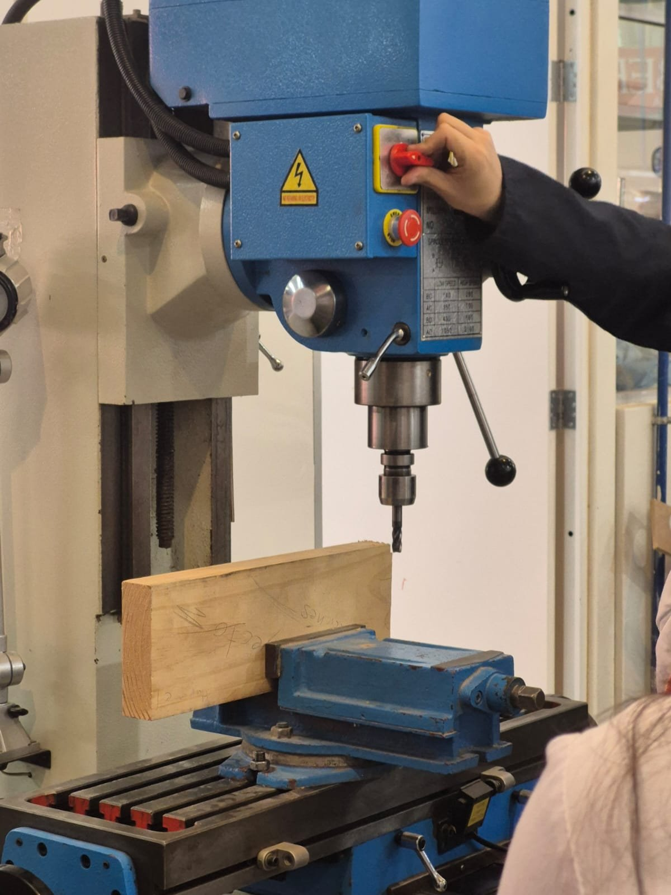
/// caption
**Broca.** Perforación de una pieza de madera en la fresadora.
///

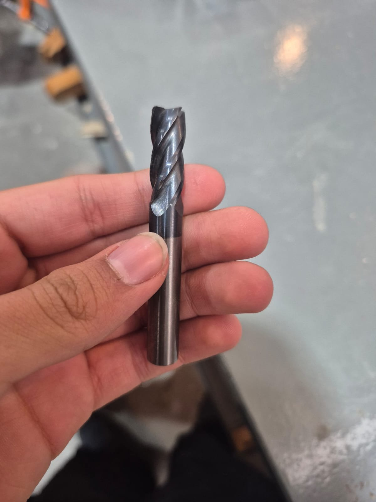
/// caption
**Fresa.** Herramienta de corte para retirar material.
///

## 4. Recorrido por las máquinas del taller

Además de las mediciones, se identificaron varios equipos y se explicaron sus funciones principales. El recorrido permitió relacionar las herramientas de corte con las operaciones que se hacen al fabricar una pieza.

### Fresadora vertical

La fresadora usa una herramienta giratoria para retirar material. Sirve para hacer superficies planas, ranuras y perfiles, según la herramienta instalada y los movimientos disponibles.

Durante la explicación se revisaron el ajuste de la máquina, la selección de velocidad, el encendido y la sujeción de las piezas. La pieza debe quedar firmemente asegurada, y los ajustes se hacen siguiendo las indicaciones de seguridad del taller.

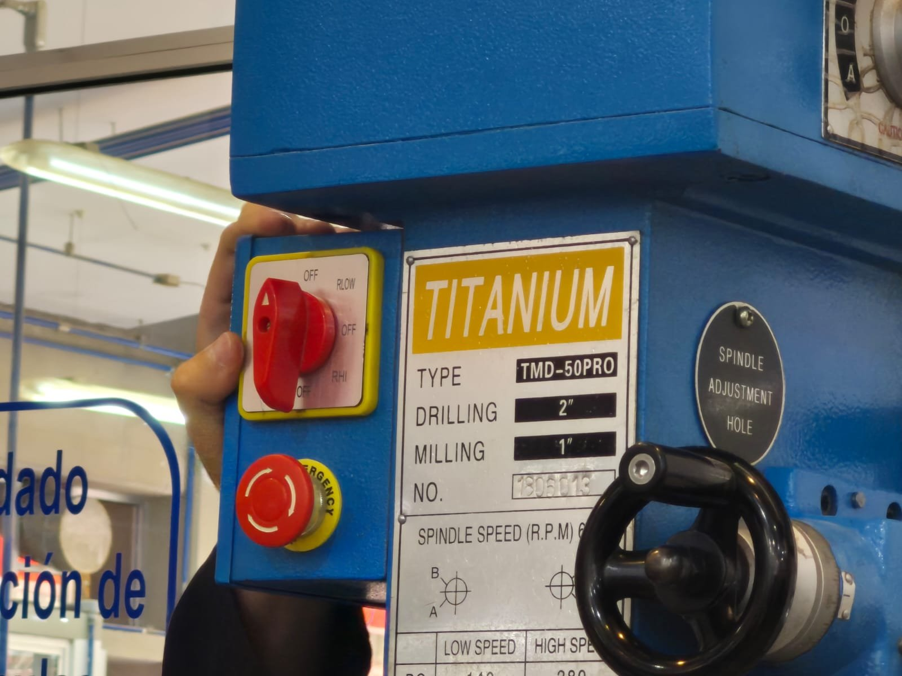
/// caption
**Placa de la fresadora.** Interruptor de encendido y datos de la máquina.
///

/// caption
**Vista de la fresadora.** Cabezal y controles de velocidad.
///

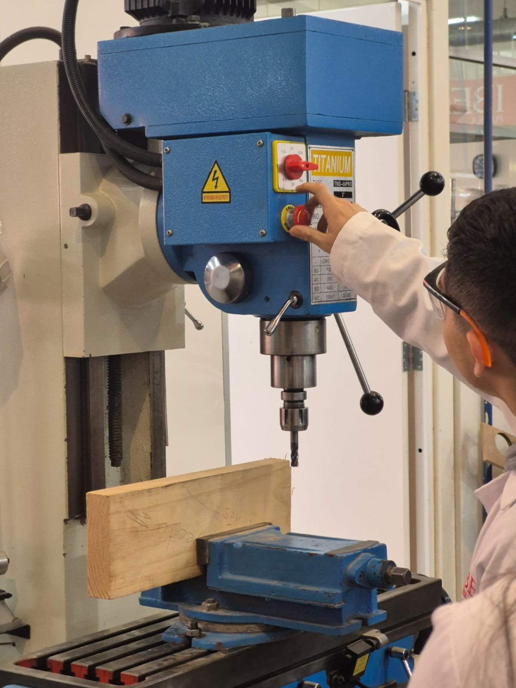
/// caption
**En operación.** Encendido de la fresadora con la pieza sujeta.
///

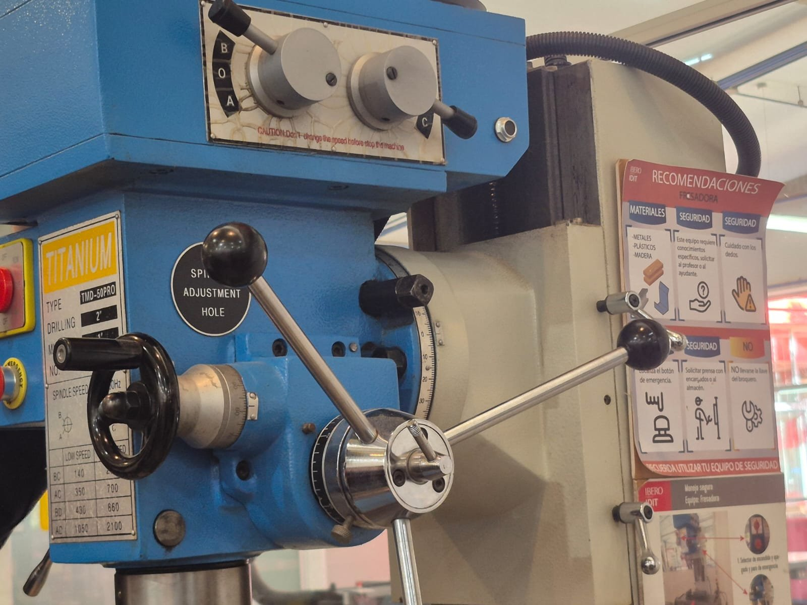
/// caption
**Controles y recomendaciones.** Palancas de ajuste y carteles de seguridad del equipo.
///

### Sierra de cinta

Esta máquina corta con una hoja metálica dentada que gira en forma de banda continua. Se usa para separar material siguiendo una trayectoria de corte, según las características de la máquina y de la pieza.

Se explicó la secuencia general de encendido y la importancia de identificar los controles antes de usarla.

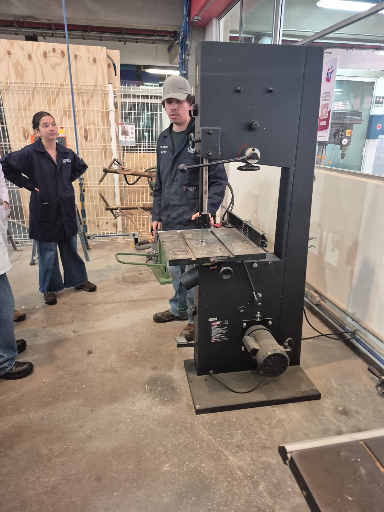
/// caption
**Sierra de cinta del taller.** Equipo de corte durante la explicación.
///

### Guillotina para lámina

La guillotina corta láminas metálicas por cizallamiento. Permite obtener cortes rectos y preparar piezas para otros procesos de fabricación.

El equipo tiene límites de capacidad según el espesor y el material. En el taller se indicó un límite de 1.5 mm para la lámina trabajada.

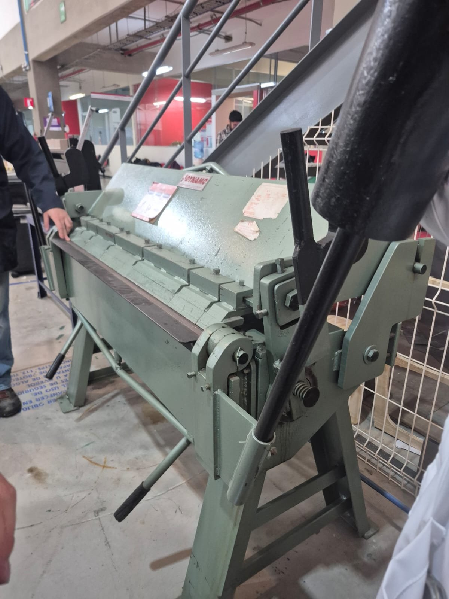
/// caption
**Guillotina.** Vista general del equipo.
///

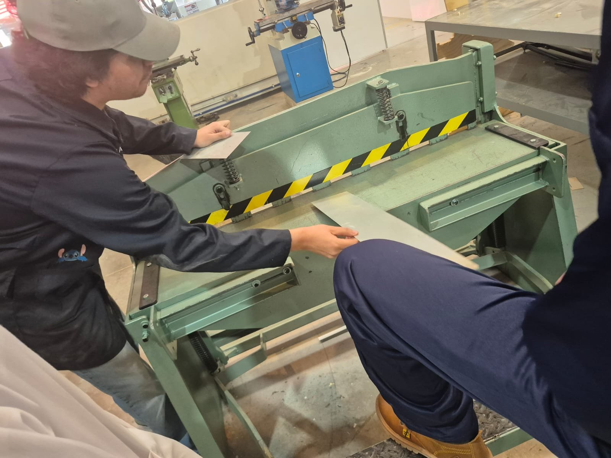
/// caption
**Corte de lámina.** Operación de la guillotina durante el corte.
///

### Dobladora de lámina

La dobladora cambia el ángulo de una lámina metálica aplicando una fuerza controlada. Así se forman pliegues y pestañas sin separar el material.

Como en la guillotina, hay que respetar los límites de espesor del equipo y colocar bien la pieza antes de cada operación.

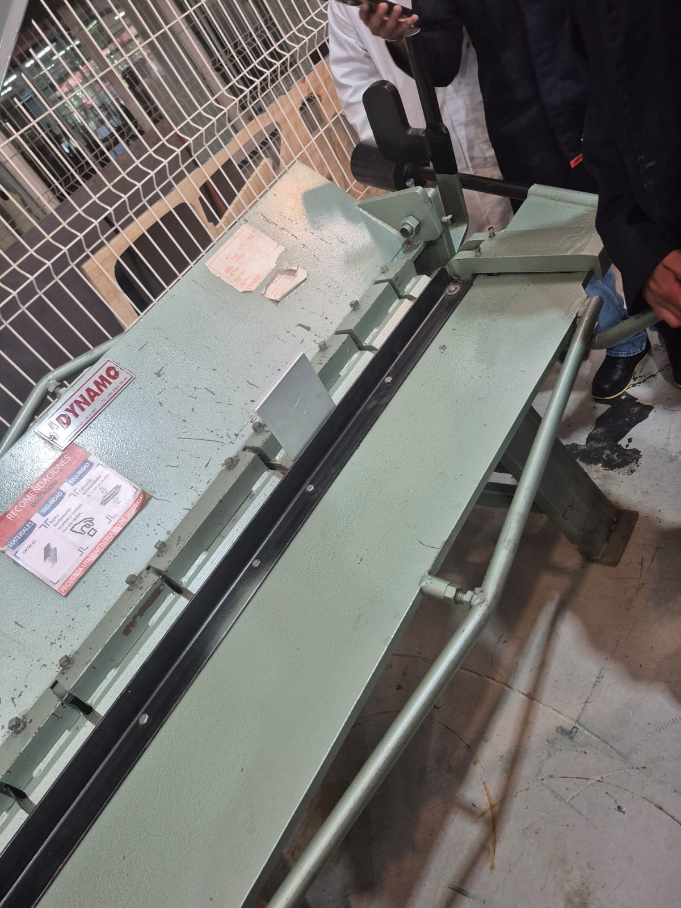
/// caption
**Dobladora.** Vista general del equipo.
///

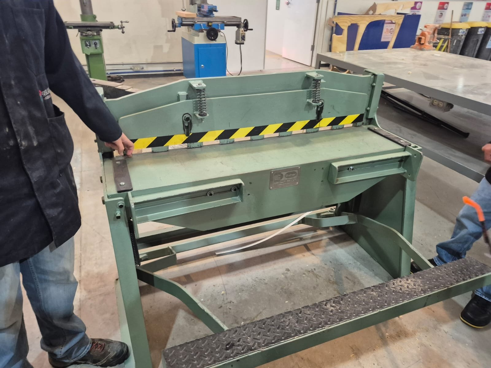
/// caption
**Segunda vista.** Detalle de la dobladora.
///

### Soldadura por puntos

La soldadura por resistencia une dos láminas metálicas con presión y el paso de corriente eléctrica entre electrodos. El calor en la zona de contacto produce una unión localizada, sin material de aporte en el proceso convencional.

Durante el recorrido se reconoció este equipo y su uso para unir componentes metálicos.

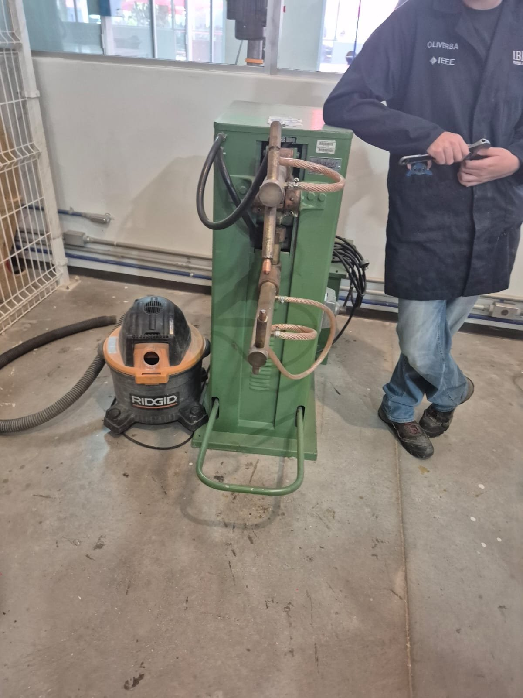
/// caption
**Soldadora por puntos.** Equipo de resistencia con sus electrodos.
///

## 5. Aprendizajes

La práctica mostró que medir es un paso importante antes de fabricar o modificar una pieza. Registrar las dimensiones ayuda a conocer sus características y a elegir el procedimiento adecuado.

También se identificaron las diferencias entre los instrumentos de medición y las funciones de varias máquinas del taller. Cada equipo hace operaciones específicas, así que conocer sus aplicaciones y límites es necesario para trabajar de forma ordenada y segura.

## Conclusión

Esta actividad ayudó a entender mejor los instrumentos de medición y la función de las máquinas que intervienen en la fabricación. Medir los bloques con el Vernier y el micrómetro permitió practicar la lectura de ambos, y reconocer la fresadora, la sierra de cinta, la guillotina, la dobladora y la soldadora por puntos mostró distintas formas de trabajar los materiales.

Aprendí que antes de fabricar una pieza hay que conocer sus dimensiones, elegir las herramientas adecuadas y entender cómo funciona cada equipo. Estos conocimientos son útiles para futuros proyectos de ingeniería y para trabajar con más precisión y seguridad.
