## Introducción

En esta práctica se conocieron diferentes etapas del proceso de maquinado por control numérico computarizado (CNC). Se trabajó con herramientas digitales para visualizar trayectorias, generar instrucciones de movimiento y preparar archivos que posteriormente pueden ejecutarse en una máquina.

También se reconocieron los componentes principales de los equipos CNC y se realizó un ejercicio práctico de corte utilizando unicel rosa. De esta manera, se relacionaron los conceptos de diseño asistido por computadora, manufactura asistida por computadora y fabricación mediante movimientos automatizados.

## 1. Visualización de trayectorias mediante NC Viewer

Antes de llevar un programa a una máquina física, es importante revisar los movimientos que realizará la herramienta. Para comprender este proceso se utilizó NC Viewer, una plataforma que permite visualizar trayectorias generadas mediante código G.

El código G contiene instrucciones que indican los desplazamientos de la máquina, las posiciones que debe alcanzar la herramienta y determinadas acciones relacionadas con el proceso de maquinado.

Durante la actividad se identificaron las siguientes funciones:

- **Editor de código:** permite introducir o modificar las instrucciones del programa.
- **Vista de simulación:** muestra gráficamente los recorridos de la herramienta.
- **Procesamiento de trayectorias:** permite actualizar la representación visual del programa.
- **Controles de reproducción:** ayudan a observar los movimientos y el orden en que se ejecutan.
- **Sistema de coordenadas:** permite interpretar las posiciones mediante los ejes X, Y y Z.

Los ejes X e Y representan los desplazamientos sobre el plano de trabajo, mientras que el eje Z corresponde al movimiento vertical de la herramienta. La posición de este último permite controlar la altura de seguridad y la profundidad de trabajo, de acuerdo con el origen y las coordenadas definidas en el programa.

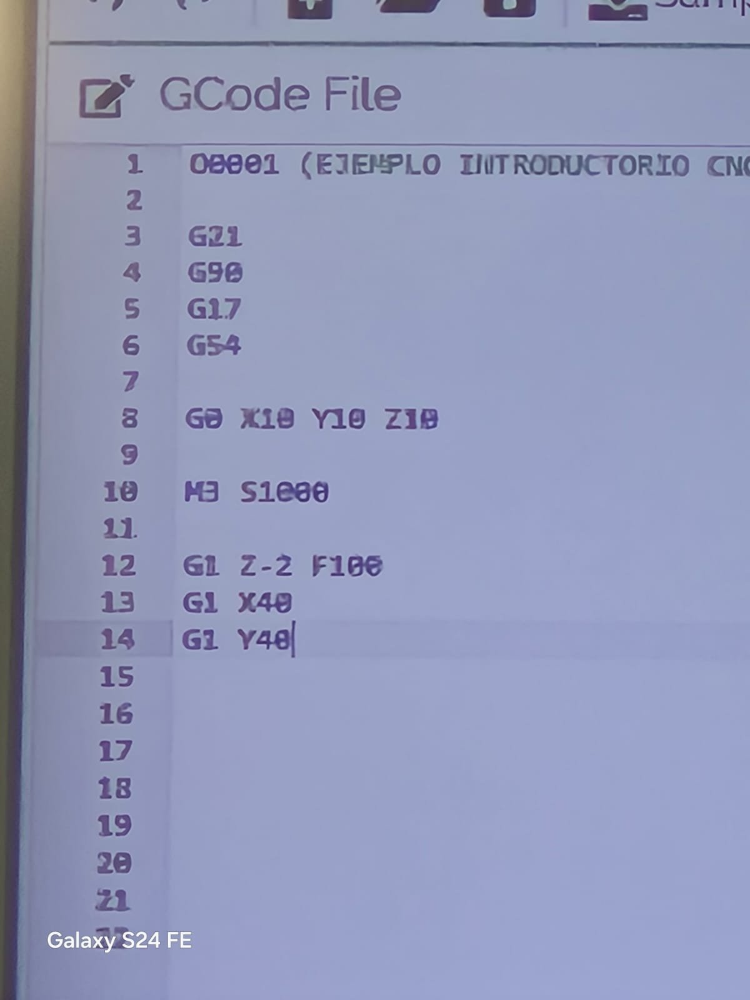
/// caption
**Código G.** Programa de ejemplo con instrucciones de movimiento abierto en el editor.
///

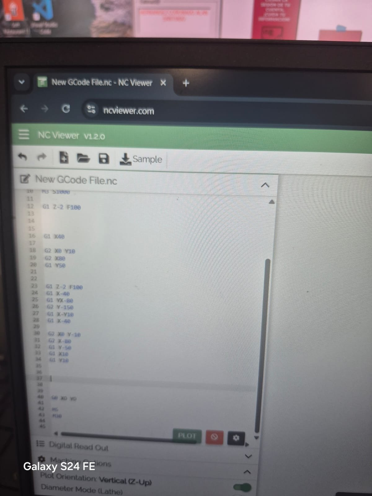
/// caption
**Editor de NC Viewer.** Líneas del programa con los movimientos G1, G2 y G0.
///

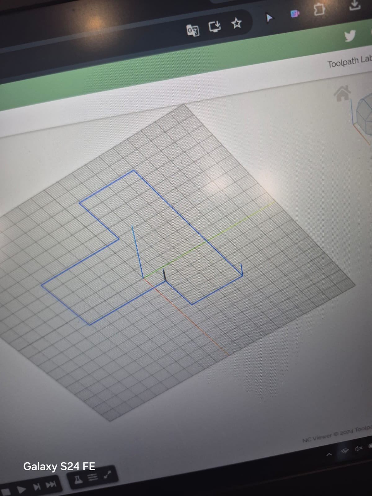
/// caption
**Simulación.** Recorrido de la herramienta visualizado sobre la cuadrícula de trabajo.
///

## 2. Preparación del maquinado con VCarve Pro

Para facilitar la generación de trayectorias se utilizó VCarve Pro, un programa CAM que permite preparar operaciones de corte a partir de diseños digitales.

A diferencia de la programación manual de cada movimiento, este software permite configurar las características del material y seleccionar estrategias de mecanizado mediante herramientas visuales.

El proceso general comprendió las siguientes etapas:

1. **Preparación del diseño:** se trabaja con una geometría creada en el programa o importada desde un archivo compatible.
2. **Definición del material:** se establecen las dimensiones del material que se va a trabajar y la ubicación del origen.
3. **Selección de la operación:** se determina qué tipo de trayectoria se necesita para obtener la forma deseada.
4. **Generación del programa:** el software calcula los movimientos de la herramienta y genera las instrucciones correspondientes.
5. **Guardado del archivo:** el programa se exporta en el formato de código compatible con el equipo CNC que se utilizará.

Entre las operaciones estudiadas se encuentran el perfilado y el cajeado. El perfilado permite seguir un contorno para recortar una forma, mientras que el cajeado elimina material dentro de una región delimitada para producir cavidades o rebajes.

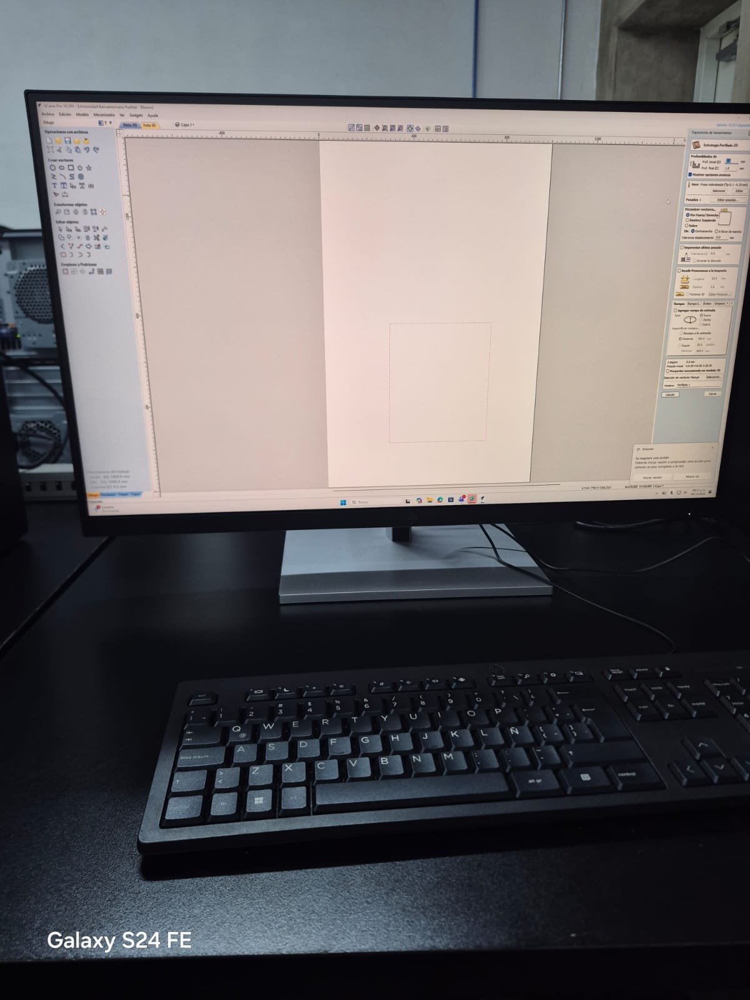
/// caption
**Proyecto en VCarve Pro.** Diseño con su material y origen definidos en el programa.
///

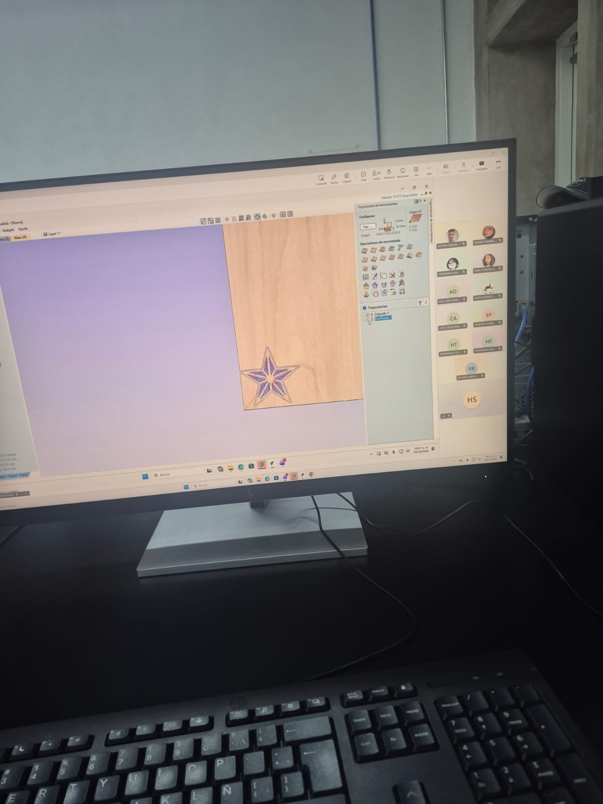
/// caption
**Perfilado y cajeado.** Trayectorias generadas sobre la estrella, con el material de referencia.
///

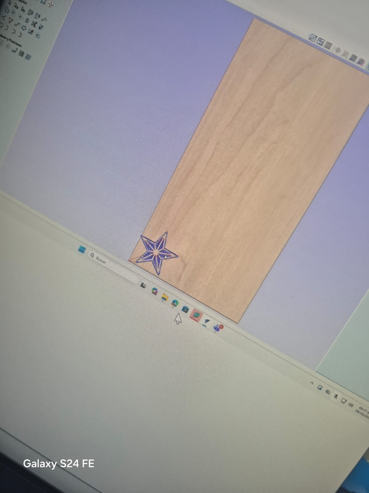
/// caption
**Detalle de la estrella.** Vista ampliada de las trayectorias antes de exportar el programa.
///

## 3. Reconocimiento de una máquina CNC de mayor tamaño

Durante la práctica también se identificó una máquina CNC de mayor tamaño, equipada con un sistema de control manual y elementos para sujetar el material durante el mecanizado.

Se revisaron algunos de sus componentes y la forma en que se prepara la herramienta antes de comenzar una operación.

### Sujeción de la herramienta

La fresa se instala en el husillo mediante un sistema de sujeción que puede incluir una boquilla o *collet*. Es importante utilizar componentes compatibles con el diámetro de la herramienta y comprobar que queden correctamente ajustados.

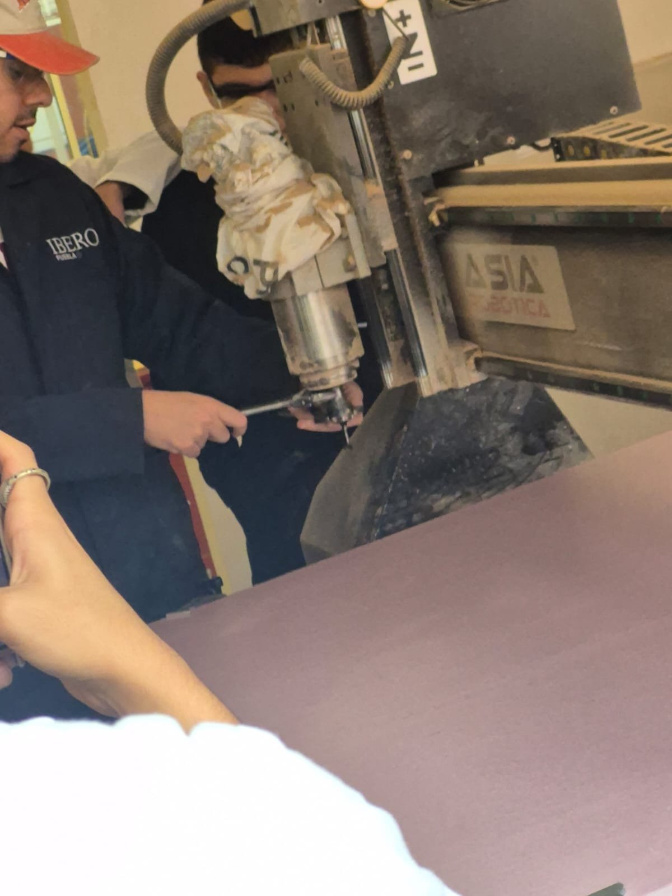
/// caption
**Husillo.** Herramienta sujeta en el cabezal antes de iniciar la operación.
///

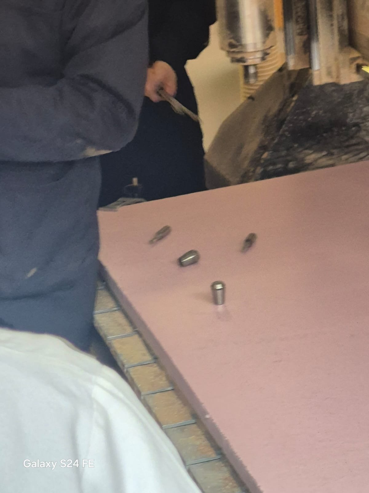
/// caption
**Herramientas de corte.** Fresas y brocas revisadas durante la práctica.
///

### Fijación del material

Para evitar desplazamientos durante el mecanizado, el material debe permanecer firmemente sujeto a la mesa. En este equipo se observaron elementos de fijación que presionan la pieza contra la superficie de trabajo.

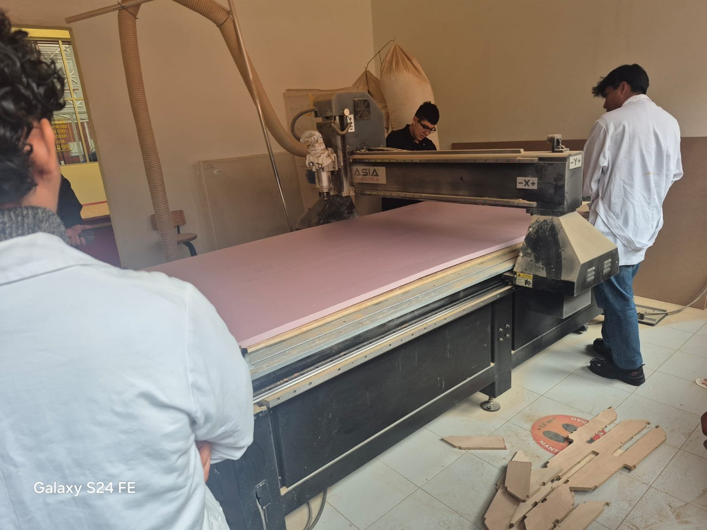
/// caption
**Material colocado.** Unicel sobre la mesa, con las piezas recortadas junto a la máquina.
///

### Selección del programa y establecimiento del origen

Se explicó cómo seleccionar un archivo desde el sistema de control y cómo posicionar los ejes para definir el origen de trabajo. Este punto de referencia permite que las coordenadas del programa correspondan con la ubicación real del material.

El origen de trabajo, identificado habitualmente mediante sistemas como G54, debe configurarse correctamente antes de iniciar el ciclo.

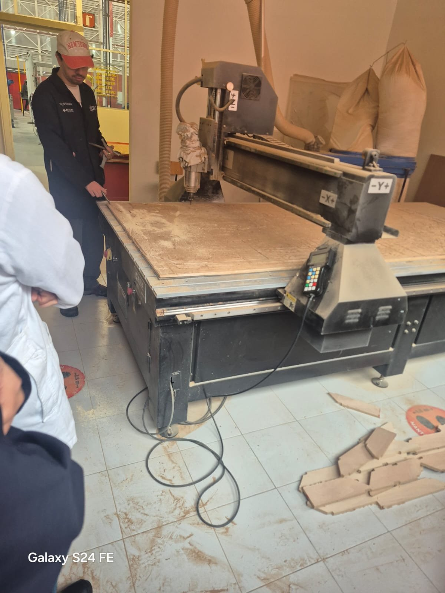
/// caption
**Panel de control.** Controles de los ejes y botones de la máquina.
///

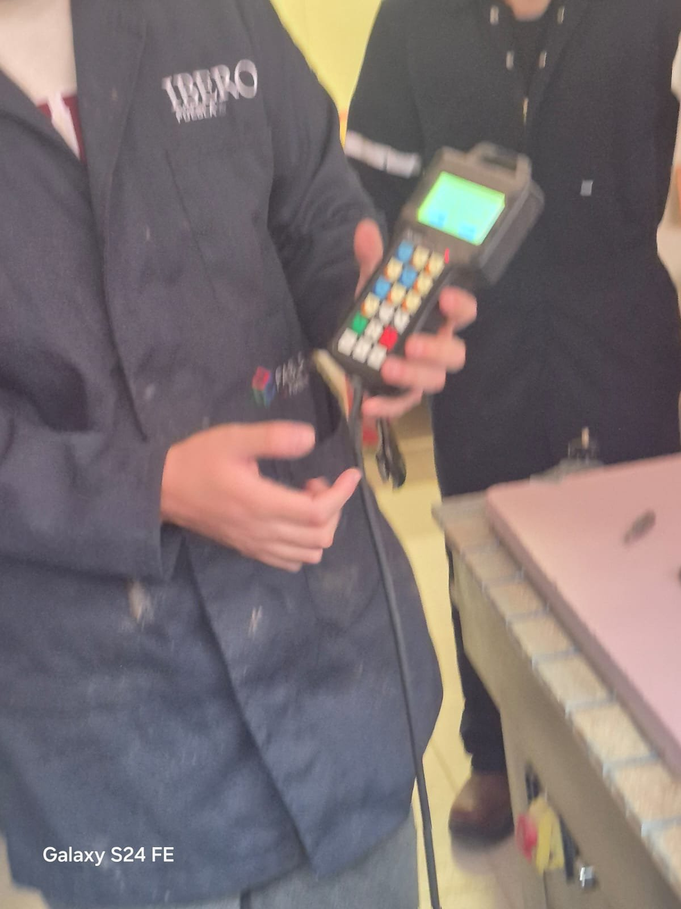
/// caption
**Control manual.** Mando portátil para mover los ejes y seleccionar el programa.
///

## 4. Aplicación práctica con unicel rosa

La parte práctica se realizó utilizando una máquina CNC controlada desde una computadora. Para el ejercicio se trabajó con unicel rosa, un material ligero que permite observar el proceso de corte y la formación de la geometría programada.

### Preparación y fijación del material

Antes de iniciar el trabajo, fue necesario colocar el material sobre la superficie de la máquina y evitar que se desplazara durante el recorrido de la herramienta.

El sistema de fijación debe seleccionarse de acuerdo con las características del material y las indicaciones del equipo. En el caso del unicel rosa, se puede emplear cinta de doble cara adecuada para mantenerlo estable, siempre que sea compatible con el procedimiento de trabajo.

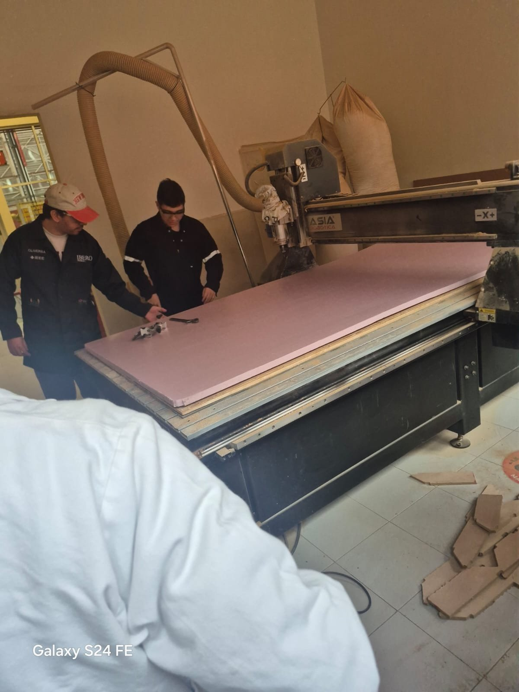
/// caption
**Unicel rosa en la máquina.** Material colocado sobre la mesa antes del corte.
///

### Configuración del programa y del origen

Una vez preparado el material, se cargó el archivo generado mediante el software CAM en el programa de control de la máquina.

Después se revisó la posición del cabezal y se establecieron los puntos de referencia de los ejes X, Y y Z. Esto permite que los movimientos programados se ejecuten respecto a la ubicación real de la pieza.

Antes de comenzar el corte, también es necesario comprobar que la herramienta, el material y la trayectoria estén correctamente preparados. Los sistemas de seguridad deben mantenerse operativos y cualquier paro de emergencia debe restablecerse únicamente cuando se hayan verificado las condiciones seguras del equipo.

### Ejecución del corte

Con la configuración revisada, se inició el ciclo de maquinado desde la interfaz de control. Durante esta etapa, la máquina realizó los movimientos programados para retirar material y formar la geometría diseñada.

El proceso permitió observar cómo las instrucciones generadas por el software se traducen en movimientos físicos de la herramienta.

## 5. Resultado del maquinado

Al finalizar el proceso se obtuvo una pieza cortada a partir del material utilizado durante la práctica. El resultado permitió relacionar el diseño preparado en el software con la trayectoria ejecutada por la máquina.

La revisión de la pieza terminada también permitió observar la forma obtenida y comprender la importancia de preparar correctamente el archivo, fijar el material y establecer el origen antes de comenzar el mecanizado.

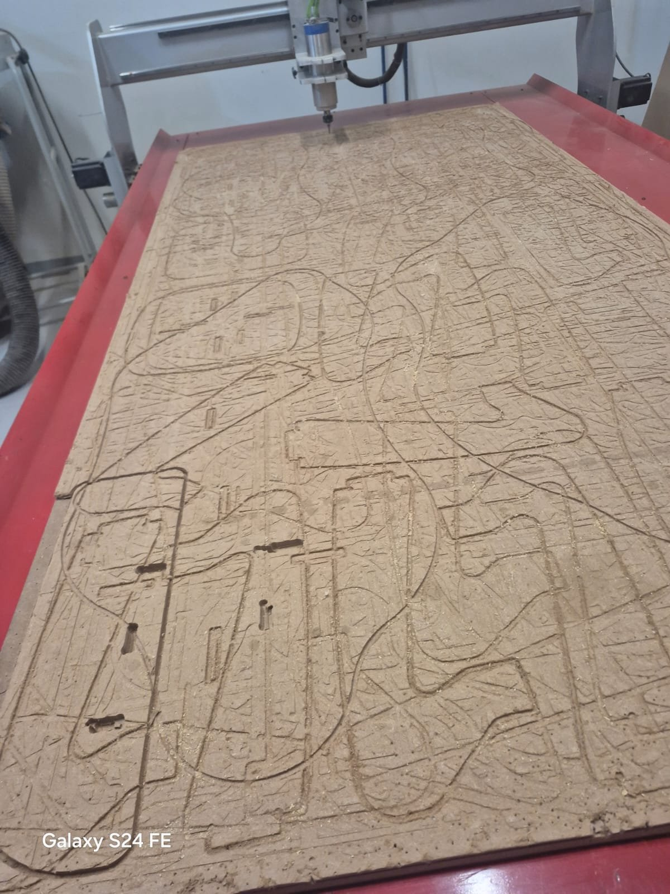
/// caption
**Resultado.** Trayectoria terminada sobre el material después del maquinado.
///

## Conclusión

Esta práctica me permitió conocer mejor el funcionamiento general de las máquinas CNC y comprender cómo se conectan el diseño digital, la preparación de trayectorias y la fabricación de una pieza.

Aprendí que NC Viewer puede ayudar a revisar un programa antes de llevarlo a la máquina, y que VCarve Pro facilita generar las trayectorias sin escribir cada movimiento a mano. También comprendí que fijar el material y establecer el origen son pasos tan importantes como el programa mismo.
